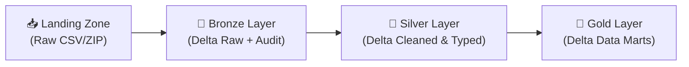

# ENEM ETL Pipeline with PySpark & Delta Lake

A minimalist data pipeline simulating an ETL process using Brazilian ENEM microdata, structured with **PySpark**, **Delta Lake**, and the **Medallion Architecture** (Landing Zone, Bronze, Silver, Gold).

---

## 🏛️ Architecture



- **Landing Zone** (`data/landing/`): Raw external files (CSV/ZIP) downloaded from INEP.
- **Bronze Layer** (`data/bronze/`): Raw data stored in **Delta Lake** format, preserving original schema with audit metadata (`_ingestion_timestamp`, `_source_file`).
- **Silver Layer** (`data/silver/`): Cleaned Delta table with standardized column names (snake_case), typed fields (`Double` for scores), dropped raw answer columns, and deduplicated records.
- **Gold Layer** (`data/gold/`): Curated business marts (average performance by state, school type comparison, and candidate fact table).

---

## 📁 Project Structure

```text
ETL-com-PySpark/
├── README.md
├── requirements.txt               # Essential dependencies
├── main.py                        # CLI pipeline runner
│
├── config/
│   ├── __init__.py
│   └── settings.py                # Paths, URLs, and column mappings
│
├── data/                          # Lakehouse storage (Landing, Bronze, Silver, Gold)
├── sample_data/
│   └── sample_enem_2020.csv       # Small dataset for fast local testing
│
├── src/
│   ├── common/
│   │   ├── logger.py              # Logging setup
│   │   └── spark_session.py       # SparkSession with Delta Lake configuration
│   ├── extract/
│   │   └── download_landing.py    # Download / extraction to Landing Zone
│   ├── transform/
│   │   ├── bronze_ingestion.py    # Landing -> Bronze (Delta)
│   │   └── silver_cleaning.py     # Bronze -> Silver (Delta)
│   └── load/
│       └── gold_aggregation.py    # Silver -> Gold (Delta)
│
└── query_lakehouse.ipynb          # Interactive notebook to query all layers in real time
```

---

## 🚀 Getting Started

### 1. Requirements
- Python 3.9+
- Java 8, 11, or 17 (required for Spark)

### 2. Setup

```bash
# Create and activate virtual environment
python3 -m venv .venv
source .venv/bin/activate  # On Windows: .venv\Scripts\activate

# Install dependencies
pip install -r requirements.txt
```

---

### 3. Running the Pipeline

#### Quick Run with Sample Data (Recommended)
Runs the entire pipeline (Extract -> Bronze -> Silver -> Gold) in seconds using local sample data:

```bash
python main.py --sample
```

#### Run with Full INEP Dataset (~3 GB)
Downloads the real ENEM 2020 dataset and executes the complete pipeline:

```bash
python main.py --step all --remove-zip
```

#### Run Individual Steps

```bash
# 1. Extract only (to Landing Zone)
python main.py --step extract --sample

# 2. Bronze only (Landing -> Bronze)
python main.py --step bronze

# 3. Silver only (Bronze -> Silver)
python main.py --step silver

# 4. Gold only (Silver -> Gold)
python main.py --step gold
```

---

### 4. Reading and Inspecting Tables (Interactive Notebook)

Open [query_lakehouse.ipynb](query_lakehouse.ipynb) in VS Code or Jupyter to inspect and query data across all layers in real time. Make sure to select the **`.venv`** kernel.
