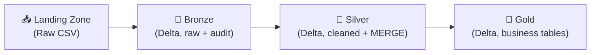

# ENEM ETL Pipeline with PySpark & Delta Lake

A minimalist data pipeline that processes Brazilian ENEM microdata with **PySpark**, stores every layer as **Delta Lake** tables and follows the **Medallion Architecture** (Landing Zone, Bronze, Silver, Gold).

The whole pipeline lives in **Jupyter notebooks**, one per layer, run in order. No orchestration, no Python modules: open, read and run.

---

## 🏛️ Architecture



| Notebook | Output | What happens |
|---|---|---|
| [01_landing](01_landing.ipynb) | `data/landing/` | Raw CSV downloaded from INEP (~3 GB) or copied from the local sample. Plain Python, no Spark. |
| [02_bronze](02_bronze.ipynb) | `data/bronze/enem_raw` | Faithful copy of the CSV in Delta, **all columns as strings**, plus `_ingestion_timestamp` and `_source_file`. Keeping Bronze untyped means a malformed value never breaks ingestion. |
| [03_silver](03_silver.ipynb) | `data/silver/enem_cleaned` | Unused columns dropped, English snake_case names, typed scores and codes, latest record per candidate, data quality checks. Written with a **Delta `MERGE`** (upsert), so re-running never duplicates candidates. Shows Delta history and **time travel**. |
| [04_gold](04_gold.ipynb) | `data/gold/` | `enem_fact_candidates` (average score + performance tier), `enem_performance_by_state` and `enem_performance_by_school`. Recomputed on every run. |

[00_setup](00_setup.ipynb) holds the shared paths and the SparkSession with Delta Lake. The Spark notebooks load it with `%run ./00_setup.ipynb`, so you never run it by hand.

**Business rule:** a candidate's `average_score` only exists when they attended all four objective exams. Absent candidates get the `Absent` tier and stay out of the averages instead of counting as zero, which would pull them down.

---

## 📁 Project Structure

```text
ETL-com-PySpark/
├── 00_setup.ipynb       # Shared paths + SparkSession with Delta Lake
├── 01_landing.ipynb     # Download / sample -> Landing Zone
├── 02_bronze.ipynb      # Landing -> Bronze
├── 03_silver.ipynb      # Bronze -> Silver (MERGE, quality checks, time travel)
├── 04_gold.ipynb        # Silver -> Gold (business tables, SQL)
├── requirements.txt
├── sample_data/         # 20-row sample for a fast local run
└── data/                # Lakehouse storage (landing, bronze, silver, gold)
```

---

## 🚀 Getting Started

### 1. Requirements (tested on Fedora Linux)

- **Python 3.12** (PySpark 3.5 doesn't officially support newer versions)
- **Java 17** (Spark runs on the JVM)

```bash
sudo dnf install python3.12 java-17-openjdk
```

### 2. Setup

```bash
python3.12 -m venv .venv
source .venv/bin/activate
pip install -r requirements.txt
```

> **First run needs internet:** Spark downloads the Delta Lake JARs from Maven once and caches them in `.ivy2/` inside the project. After that, everything runs offline.

### 3. Run

Start Jupyter from the project root (or open the folder in VS Code and pick the **`.venv`** kernel):

```bash
jupyter lab
```

Run the notebooks in order: `01_landing` → `02_bronze` → `03_silver` → `04_gold`.

In `01_landing`, `USE_SAMPLE = True` (default) uses the local 20-row sample. Set it to `False` to download the real ENEM 2020 dataset.
